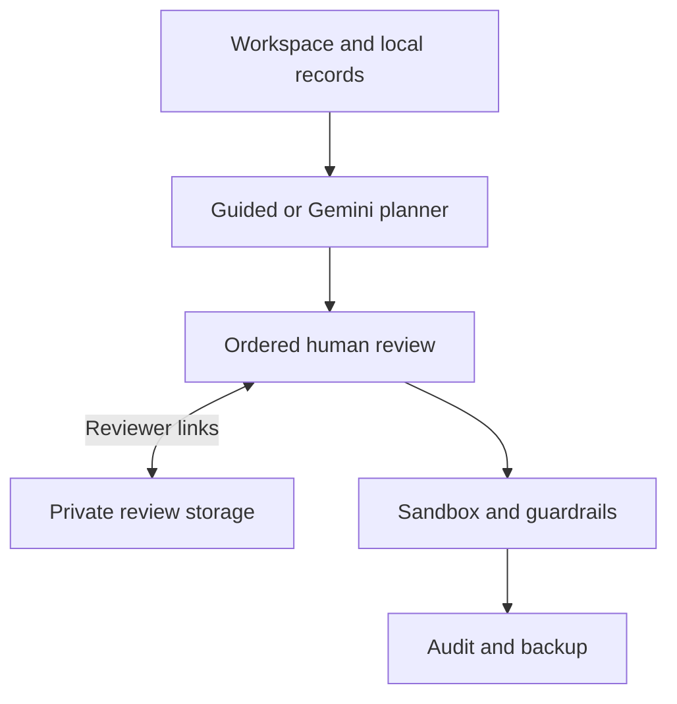

# Before the Click

Before the Click is a rehearsal workspace for founder teams. Start with launch-week inbox triage, a calendar clash, or a shared folder. Inspect a proposed plan, gather human decisions in order, and run it against sandbox records. The audit shows which actions applied, which a rule blocked, and what changed.

- [Open the workspace](https://before-the-click.vercel.app/workspace)
- [Read the field guide](https://before-the-click.vercel.app/guide)

## Run locally

Use Node.js 22.18 or later.

```sh
npm ci
npm test
npm run dev
```

Open [localhost:3000](http://localhost:3000). A local development session uses in-process review storage if a Blob store is absent. Restarting the development server clears those shared links. Private review storage is required in production.

## Production

Deploy as a Next.js project on Vercel. Connect a **private** Vercel Blob store for review packets and request counters. Vercel supplies the storage credentials through a linked read-write token or OIDC configuration.

To enable Gemini planning, add `GEMINI_API_KEY` as a **sensitive Production** variable on the existing Vercel project and redeploy. `GEMINI_MODEL` is optional and defaults to `gemini-2.5-flash`. The guided planner runs locally in the browser and is available before Gemini setup.

## What reviewers can do

- Review in the workspace or share a separate link for each pending reviewer.
- Approve, request changes, or reject when the reviewer’s turn arrives.
- Refresh the owner’s queue to load shared decisions. Closing the links keeps previously recorded decisions.
- Edit the request and restart the review, compare a duplicate plan, or archive and download a completed rehearsal.

Review links expire after 14 days. Anyone holding a link can act for that reviewer, so send it directly. Shared packets exclude the details of sources marked private. Browser backups contain rehearsal records and guardrail settings. Invitations stay in the originating browser.

## Architecture



The simulator applies allowlisted operations to copied sandbox records in order. It produces drafts, state changes and a record of each outcome. It has no dispatch connection to a live inbox, calendar, or file provider.

## Runtime and privacy

The guided planner uses browser rules and needs no model. Gemini makes one model request per generated plan. For a free-access competition submission, configure a Google AI Studio free-tier key and verify the current model quota. The server substitutes placeholders for sensitive sources before calling the model. Users should keep confidential details out of the goal and any sources they share. The proposal validator limits actions to existing records and the operations allowed for the scenario.

Codex assisted with implementation and testing. OpenAI image generation supplied the limestone sculpture and campus illustration. These tools are not called by the running site.
